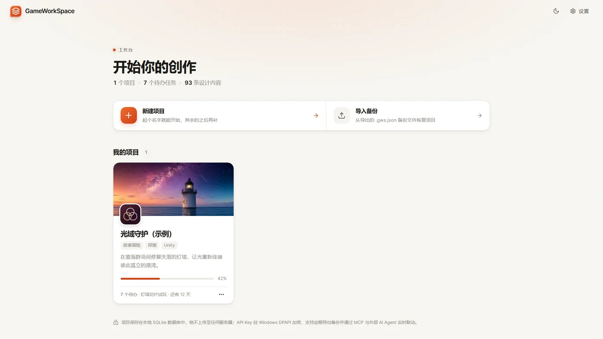
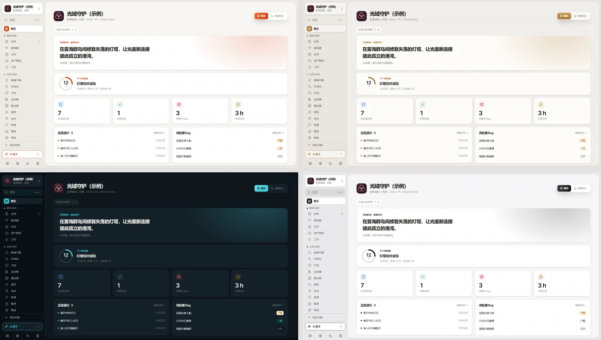
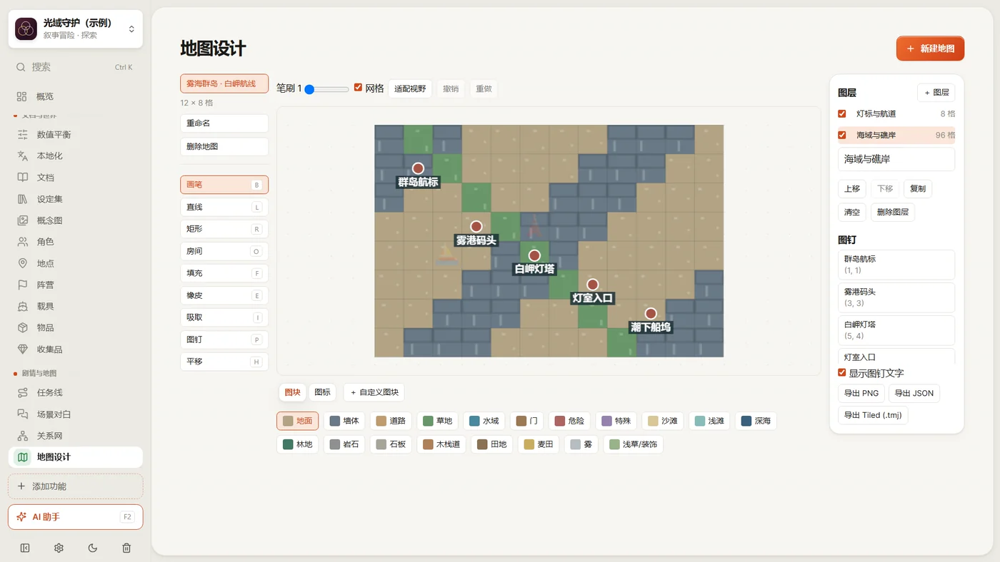
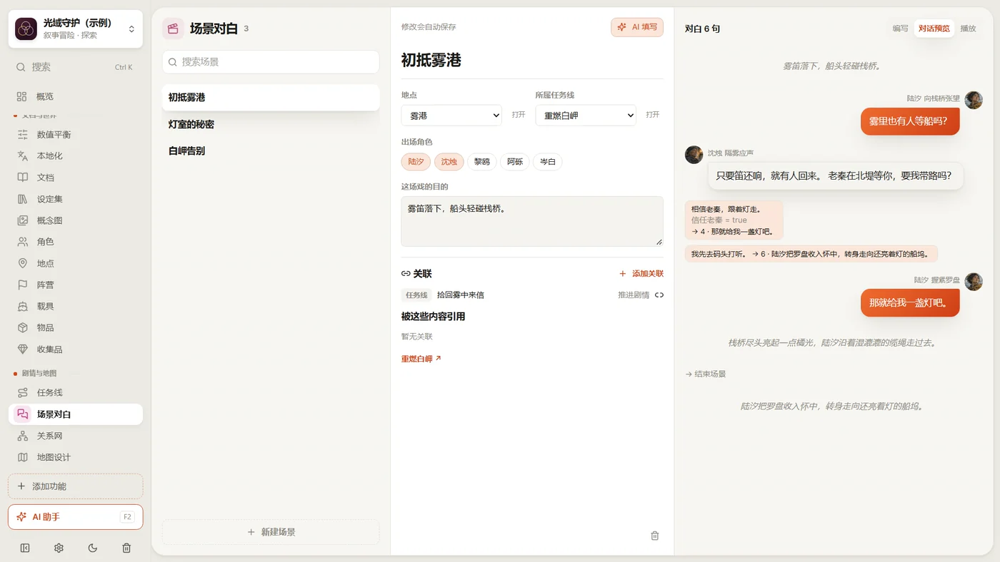
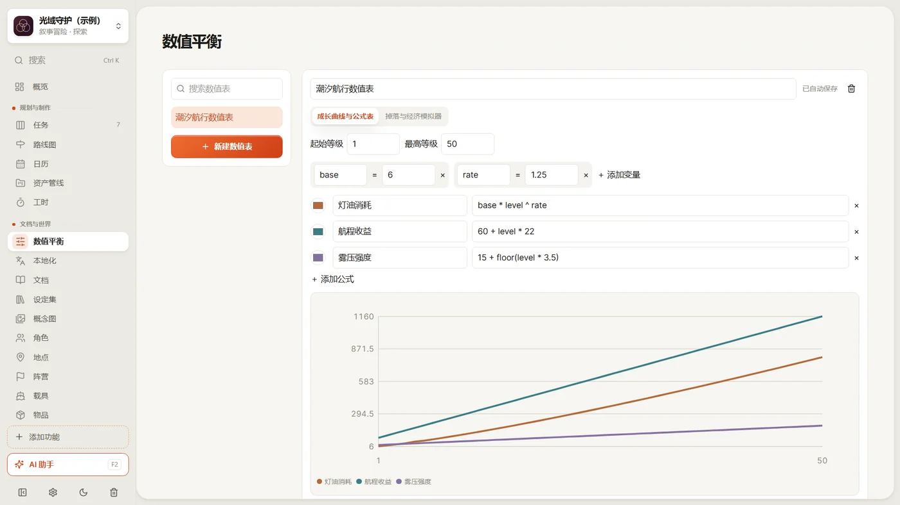
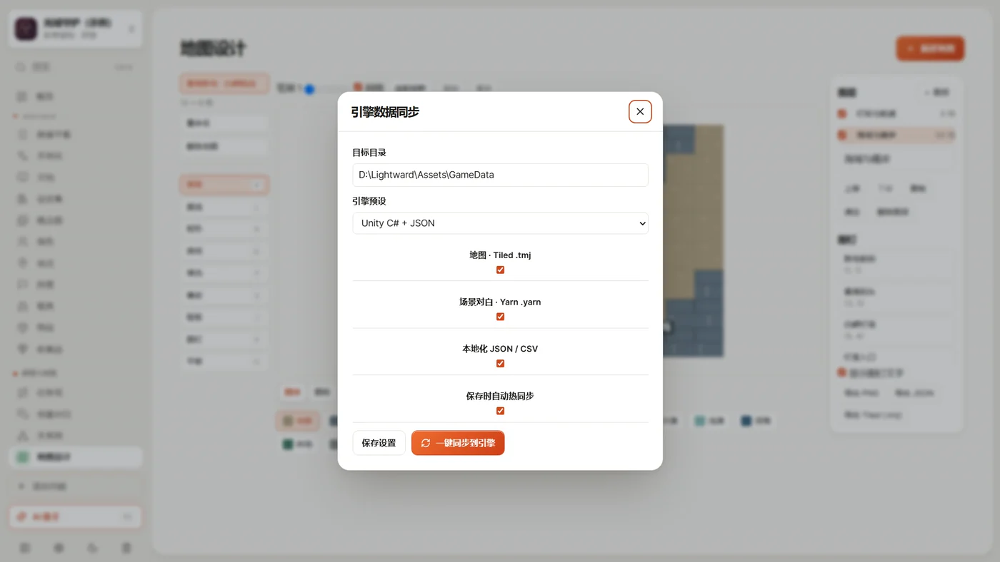
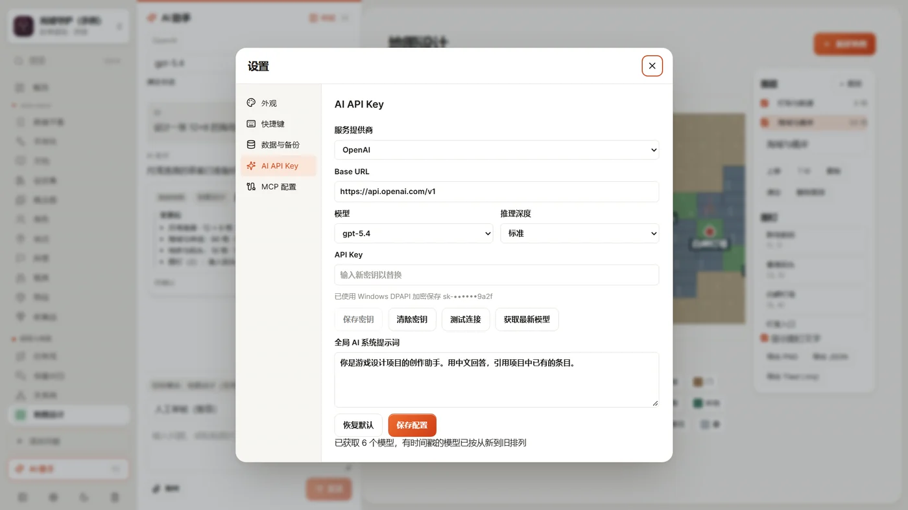
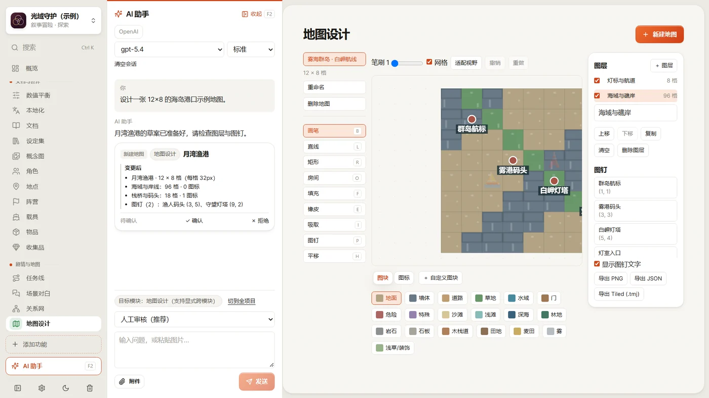
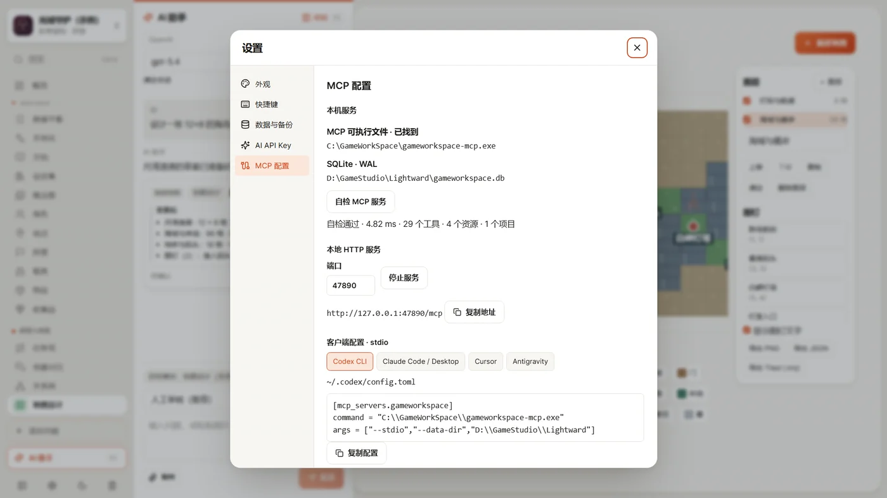

<div align="center">

<h1>GameWorkSpace</h1>
<p><strong>本地优先、AI 原生的 Windows 游戏开发工作台</strong></p>

<p>
  
  
  
  
  <a href="LICENSE"></a>
</p>

<p>
  <a href="#highlights">核心亮点</a> ·
  <a href="#themes">四套主题</a> ·
  <a href="#tools">制作工具</a> ·
  <a href="#ai">全模块 AI 助手</a> ·
  <a href="#mcp">原生 MCP 服务</a> ·
  <a href="#build">从源码构建</a>
</p>


</div>

<a name="highlights"></a>

## ✨ 核心亮点

- **本地优先** · 项目保存在本机 SQLite 数据库里。随时可导出 Markdown 设计文档、Agent ZIP 包或含资源的 `.gws.json` 备份。
- **23 个制作模块** · 从任务看板进入关卡地图、角色和分支对白，也能在同一项目里管理资产、平衡数值和跟踪 Bug。
- **全模块 AI 协作** · 自带服务商密钥（BYOK），让助手按当前模块提出修改。在预览中勾选要采用的改动，应用后仍可回滚。
- **29 个 MCP 工具与引擎热同步** · 外部 Agent 写入项目后，桌面自动刷新。启用引擎同步后，每次保存都会更新目标目录中的游戏数据。

> **快速开始** · 安装 Microsoft Edge WebView2 Runtime，双击 `target/release/gameworkspace.exe`。发布程序已内嵌前端，首次打开空工作区会自动创建「光域守护」示例项目。按 `Ctrl+K` 全局检索，按 `F2` 呼出 AI 助手。

<a name="themes"></a>

## 🎨 四套精致外观主题

上排从左到右是 **Warm Paper（暖纸，默认）** 和 **Liquid Glass（液态玻璃）**，下排是 **Deep Sea（深海）** 和 **Ink White（墨白）**。在设置中切换主题，过渡动画跟随系统的减少动态效果设置。



<a name="tools"></a>

## 🛠️ 核心制作工具一览

<table>
<tr>
<td width="50%" valign="top">
<p><strong>🗺️ 地图设计与三格式导出</strong></p>
<a href="docs/screenshots/mapmaker.webp"></a>
<p>分图层绘制地形、放置图标和图钉。通过 Windows 原生保存框导出原始分辨率的高清 PNG、保留图层与图钉的 JSON，或 Tiled 地图（<code>.tmj</code> 附 <code>.bmp</code> 图集）。</p>
</td>
<td width="50%" valign="top">
<p><strong>💬 场景对白与分支试玩</strong></p>
<a href="docs/screenshots/scenes.webp"></a>
<p>为台词与选项设置条件、跳转和变量赋值。试玩时可调整变量，按数字键 1–9 选择分支，按 ← 回到上一步的台词和变量状态。</p>
</td>
</tr>
<tr>
<td width="50%" valign="top">
<p><strong>📈 数值平衡与掉落模拟</strong></p>
<a href="docs/screenshots/balance.webp"></a>
<p>用公式和命名变量比较多条成长曲线，逐级覆盖数值并导出 CSV 或 JSON。按权重与数量区间模拟掉落，固定种子即可复现结果，对照期望收益和实际产出。</p>
</td>
<td width="50%" valign="top">
<p><strong>🚀 游戏引擎一键热同步</strong></p>
<a href="docs/screenshots/engine-sync.webp"></a>
<p>选择 Unity、Godot、Unreal 或通用 JSON 预设，一键将 Yarn Spinner 对白、Tiled 地图与本地化表写入目标目录，也可在每次保存后自动导出。</p>
</td>
</tr>
</table>

- **资产管线** · 按阶段跟踪美术与音频，关联角色、地点等条目。音频支持播放和拖动定位，项目概览会列出待替换的灰盒资源。
- **多语种本地化** · 从世界条目、对白和分支选项中提取文本，保留已有译文。可添加语种、逐条编辑或批量翻译缺失项，再导出 CSV / JSON。BYOK 翻译会参考项目题材、角色性格和说话方式。
- **数据迁移与 7 份滚动快照** · 可迁移整个工作区目录，迁移后重启桌面与 MCP。自动和手动快照合计保留最近 7 份，恢复时会创建项目副本。

<a name="ai"></a>

## 🤖 全模块 AI 助手与实时模型获取（BYOK）

<table>
<tr>
<td width="50%" valign="top">
<p><strong>选择服务商与模型</strong></p>
<a href="docs/screenshots/ai-settings.webp"></a>
<p>在「设置 → AI API Key」选择服务商或填写兼容接口地址。保存密钥后可测试连接。点击「获取最新模型」会请求服务商的 <code>/models</code>，按创建时间从新到旧排列带时间戳的模型，也可输入自定义模型 ID。</p>
<p>密钥由当前 Windows 用户的 DPAPI 加密，保存在数据目录的 <code>secrets.bin</code>。MCP 资源、审计和项目导出只使用项目数据。</p>
</td>
<td width="50%" valign="top">
<p><strong>预览、审核与回滚</strong></p>
<a href="docs/screenshots/ai-assistant.webp"></a>
<p>按 <kbd>F2</kbd> 打开助手。发送时默认锁定当前模块。10 种写操作覆盖条目与地图的增删改、关系连线的增删，以及合成配方的写入与删除。日历和工时数据只读。</p>
<p>在结构化预览里逐项或批量审核。应用后点击「去查看」即可定位到改动，也可回滚提议。</p>
</td>
</tr>
</table>

<a name="mcp"></a>

## 🔌 原生 MCP 服务（29 个工具 · 300ms 实时热同步）

外部 Agent 可用 29 个工具编辑项目，包括新建地图、修改图层格子和放置图钉。桌面每 300 毫秒检查一次数据库变更，自动刷新当前工作区。



将 `gameworkspace-mcp.exe` 放在桌面程序同一目录。在 **设置 → MCP 配置** 中点击「自检 MCP 服务」，可查看握手耗时、工具数和可读资源数。选择客户端，将 stdio 片段合入下表所列的配置文件。片段会自动填入程序与数据目录的绝对路径。保存后在客户端重新加载 MCP 服务，调用 `list_projects` 验证连接。

| 客户端 | stdio 配置位置 | 连接已启动的本地 HTTP 服务 |
| --- | --- | --- |
| Codex CLI | `~/.codex/config.toml` 的 `[mcp_servers.gameworkspace]` | `codex mcp add gameworkspace --url http://127.0.0.1:47890/mcp` |
| Claude Code / Desktop | Code 项目的 `.mcp.json` 或 Desktop 的 `%APPDATA%\Claude\claude_desktop_config.json`，合入 `mcpServers` | Code 执行 `claude mcp add --transport http gameworkspace http://127.0.0.1:47890/mcp`。Desktop 本机接入使用左列 stdio 配置。 |
| Cursor | 项目 `.cursor/mcp.json` 的 `mcpServers` | 服务条目填入 `{"url":"http://127.0.0.1:47890/mcp"}` |
| Antigravity | MCP Servers → Manage MCP Servers → View raw config 中的 `mcp_config.json` | 服务条目填入 `{"serverUrl":"http://127.0.0.1:47890/mcp"}` |

<details>
<summary><strong>运行 HTTP 服务与令牌认证</strong></summary>

stdio 客户端启动独立进程，桌面关闭后仍可读写。设置页可启动或停止内嵌 HTTP 服务，关闭桌面会一起停止该服务。也可在 PowerShell 中独立启动，按 `Ctrl+C` 停止。

```powershell
.\target\release\gameworkspace-mcp.exe --http 127.0.0.1:47890
```

默认只绑定 `127.0.0.1`，端口为 `47890`。需要认证时追加 `--token <TOKEN>`，客户端随请求发送 `Authorization: Bearer <TOKEN>`。健康检查使用 `GET /health`，JSON-RPC 入口为 `POST /mcp`。支持协议版本 `2024-11-05` 和 `2025-03-26`。[MCP 传输规范](https://modelcontextprotocol.io/specification/2025-03-26/basic/transports)

</details>

<details>
<summary><strong>共享数据库、目录优先级与写入记录</strong></summary>

桌面与 MCP 共享 SQLite WAL 数据库 `gameworkspace.db`。两者依次查找以下数据目录。

1. 启动参数 `--data-dir` 指定的目录。
2. 环境变量 `GAMEWORKSPACE_DATA_DIR` 指定的目录。
3. 工作区迁移时保存的目录。
4. 默认目录 `%APPDATA%\com.gameworkspace.app`。

MCP 配置页展示最近 50 条 MCP 写入。

</details>

<details>
<summary><strong>Agent 工作流与批量修改示例</strong></summary>

先读 `gws://projects` 取得项目 ID，再读取该项目的 `gws://project/{projectId}/overview`、`gws://project/{projectId}/schema` 或 `gws://project/{projectId}/export/markdown`。工具覆盖条目检索与编辑、双向关联、任务流程校验、地图、配方、工时及导出。设置页列出与服务端一致的完整工具目录。

调用 `batch_apply_changes` 可预览一批修改。下面的示例为「光域守护」起草一条关卡评审文档。

```json
{
  "projectId": "lightward",
  "mode": "dry_run",
  "operations": [
    {"operation": "create_entity", "entityType": "doc", "title": "灯塔关卡评审"}
  ]
}
```

批量改动默认预览。`dry_run` 返回逐项的前后快照，`review` 将提议送到项目 AI 面板，`apply` 在同一事务内写入改动和回滚快照。调用 `export_agent_bundle` 可直接取得 Markdown，指定 `outputPath` 可写出 `.md`、`.zip` 或 `.gws.json`。

</details>

## 🧩 23 个核心模块矩阵

在项目的「功能管理」中启用所需模块，通过可收起的左侧栏切换。删除的条目在回收站保留 14 天。

| 工作区 | 模块 |
| --- | --- |
| 总览 | 概览与数据统计 |
| 规划与制作 | 任务看板、路线图与里程碑、日历、工时、资产管线 |
| 文档与世界 | 文档、设定集、概念图、角色、地点、阵营、载具、物品与合成树、收集品、数值平衡、本地化 |
| 剧情与地图 | 任务线与流程走查、场景对白、关系网、地图设计 |
| 测试与记录 | Bug 追踪、开发日志 |

<a name="build"></a>

## 📦 从源码构建

在 Windows 上安装 Node.js、Rust MSVC 工具链、Visual Studio C++ Build Tools 和 Microsoft Edge WebView2 Runtime。在仓库根目录运行以下 PowerShell 命令。

```powershell
npm ci
npm run build
cargo test --workspace
cargo clippy --workspace --all-targets -- -D warnings
cargo build --release --workspace --features gameworkspace/custom-protocol
```

开发模式使用 `npm run tauri dev`。发布构建生成 `target/release/gameworkspace.exe` 与 `target/release/gameworkspace-mcp.exe`。端到端测试使用临时数据库，覆盖真实 stdio 子进程、HTTP、200 次 WAL 并发写入与读取，以及一万个条目的 FTS5 和中文短词检索。

## 🎬 参考视频

本项目的制作参考了[这期哔哩哔哩视频](https://www.bilibili.com/video/BV1gHsz6ZE5H)。

## 📄 License

项目采用 [MIT License](LICENSE)。
